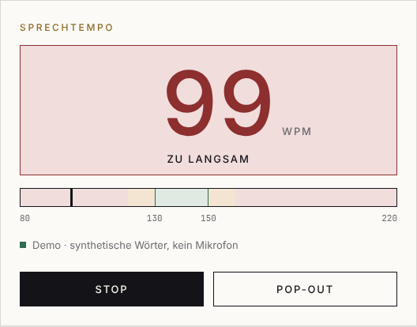
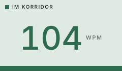
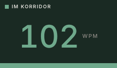

<div align="center">

# 🎙️ Word Pace

**See how fast you speak, live, in words per minute.**
One HTML file. Runs in your browser. Stores nothing.

[](https://github.com/nullthrone/word-pace-track/actions/workflows/pages.yml)
[](LICENSE)
[](index.html)
[](#-privacy)
[](https://ko-fi.com/tsprock)

### 👉 [Open Word Pace](https://nullthrone.github.io/word-pace-track/) · [Try the demo](https://nullthrone.github.io/word-pace-track/?demo=1)



</div>

---

## 🤔 Why

Most people speak faster than they think, and faster still when they know the material or feel nervous. Listeners hearing it for the first time fall behind, and in a recording, a talk or a video call nobody stops you to say so. Your own sense of speed is a poor judge, because you already know what comes next.

Word Pace gives you an outside reference while you speak: a live words-per-minute number, and a panel that turns green, amber or red against the corridor you set. Use it to rehearse a presentation, record a video or podcast, read aloud, practise a language or keep a steady pace on a call.

## ✨ Features

- 🔢 **Live WPM**, updated twice a second over a sliding window (default 15 s).
- ⏸️ **Pauses don't count.** Silence neither lowers the number nor drops it to zero; the value freezes and shows *Pause*.
- 🎯 **Target corridor** (default 130–150 WPM) with 10 WPM amber bands and a text label, so it reads without colour too.
- 🪟 **Pop-out**: a tiny always-on-top window next to Zoom or your recording app (Chrome, Edge). Safari and Firefox get a small popup.
- 🔁 **Auto-restart** when the browser's recognition times out or the network hiccups, with backoff.
- 📊 **Session summary**: duration, peak, average over speaking time *and* over total duration, time in each zone.
- 🔔 **Optional beep** after 5 s in the red.
- 🌗 **Light and dark** following your system setting.
- 🔗 **Settings in the URL** (`#min=130&max=150&w=15…`): bookmark a setup, nothing is saved on the device.
- 🧪 **Demo mode** (`?demo=1`): a synthetic 100→200 WPM ramp, no microphone needed.

<div align="center">

&nbsp;&nbsp;

</div>

## 🚀 Quick start

1. Open **[nullthrone.github.io/word-pace-track](https://nullthrone.github.io/word-pace-track/)** in Chrome or Safari.
2. Click **Start** and allow the microphone.
3. Speak. A value appears after about 4 s of speech.
4. Optional: click **Pop-out** and put the mini window next to your recording app.

Running it locally:

```bash
git clone https://github.com/nullthrone/word-pace-track.git
cd word-pace-track
npm start   # http://localhost:8000 — the microphone works on localhost and HTTPS only
```

## 🧮 How it measures

The browser's speech recognition (Web Speech API) streams a transcript. Word Pace only counts how much the word count *grows* between updates, stamps each increase with a time, and forgets the words themselves.

```
WPM = words in window / speaking time in window × 60
```

**Speaking time** is the time between word events, with each gap capped at the pause threshold *P* (default 1.5 s, adjustable 0.8–3 s). A gap longer than *P* is a pause: it adds at most *P* and the display freezes. The shown number is smoothed (EMA, factor 0.3).

Good to know:

- While a pause is still inside the window, up to *P* of it counts as speech, so the value can read up to ~10 % low until the pause leaves the window.
- Tools that divide by the *total* duration, pauses included, report a lower number than speaking-time WPM. Switch on **Pausen einrechnen** to compare, or read both averages in the session summary.
- Recognition delivers words in bursts with some latency. Accuracy target: within 15 % of a stopwatch count.

## 🔒 Privacy

- No audio, transcript or word list is stored. The buffer holds only timestamps and counts.
- No `localStorage`, cookies or IndexedDB. No analytics, no fonts or scripts from third parties.
- A Content-Security-Policy (`connect-src 'none'`) stops the page itself from sending data anywhere.
- ⚠️ **The browser's speech service is the exception.** Chrome sends audio to Google, Safari to Apple. The page cannot change that. If your content is confidential, practise with neutral text.

## 🌐 Browser support

| Browser | Live WPM | Pop-out |
| --- | --- | --- |
| Chrome / Edge (desktop) | ✅ | ✅ always on top (Document Picture-in-Picture) |
| Safari (macOS) | ✅ | ☑️ small popup, not always on top |
| Firefox | ❌ no Web Speech API (demo mode works) | ☑️ popup |

Keep the main tab open; the pop-out only mirrors it.

## ⚙️ Settings

All settings live in the URL fragment, so a bookmark keeps them:

| Key | Meaning | Default | Range |
| --- | --- | --- | --- |
| `min` / `max` | Target corridor in WPM | 130 / 150 | 60–250 / 70–300 |
| `w` | Window length in seconds | 15 | 10–30 |
| `p` | Pause threshold in seconds | 1.5 | 0.8–3 |
| `lang` | Recognition language | `de-DE` | `de-DE`, `en-US` |
| `pauses` | Count pauses (total-duration mode) | 0 | 0 / 1 |
| `beep` | Beep after 5 s in the red | 0 | 0 / 1 |

Example: `https://nullthrone.github.io/word-pace-track/#min=140&max=160&lang=en-US`

## 🛠️ Development

Everything is in [`index.html`](index.html): inline CSS (Nullthrone design tokens) and two scripts. The pure counting and window logic sits in `<script id="wpt-core">` without DOM access, so the tests load it on its own.

```bash
npm test                 # unit tests (node:test, no dependencies)
npm run test:browser     # demo mode in headless Chromium (needs playwright)
```

## 🚢 Deployment

Every push to `main` runs the tests and publishes `index.html` to **GitHub Pages** via [`.github/workflows/pages.yml`](.github/workflows/pages.yml). One-time setup: *Settings → Pages → Source: GitHub Actions*.

GitHub Pages cannot set custom response headers. The Content-Security-Policy and referrer policy therefore ship as `<meta>` tags; `Permissions-Policy` has no meta equivalent and is not set.

## 🤝 Contributing

Ideas, measurement reports and pull requests are welcome. Start with [CONTRIBUTING.md](CONTRIBUTING.md); it lists the few promises the project keeps (one file, no data leaves the page).

## ☕ Support

If Word Pace saved you a re-recording, you can buy me a coffee:

<a href="https://ko-fi.com/tsprock"></a>

## 📜 License

[MIT](LICENSE) © Nullthrone
